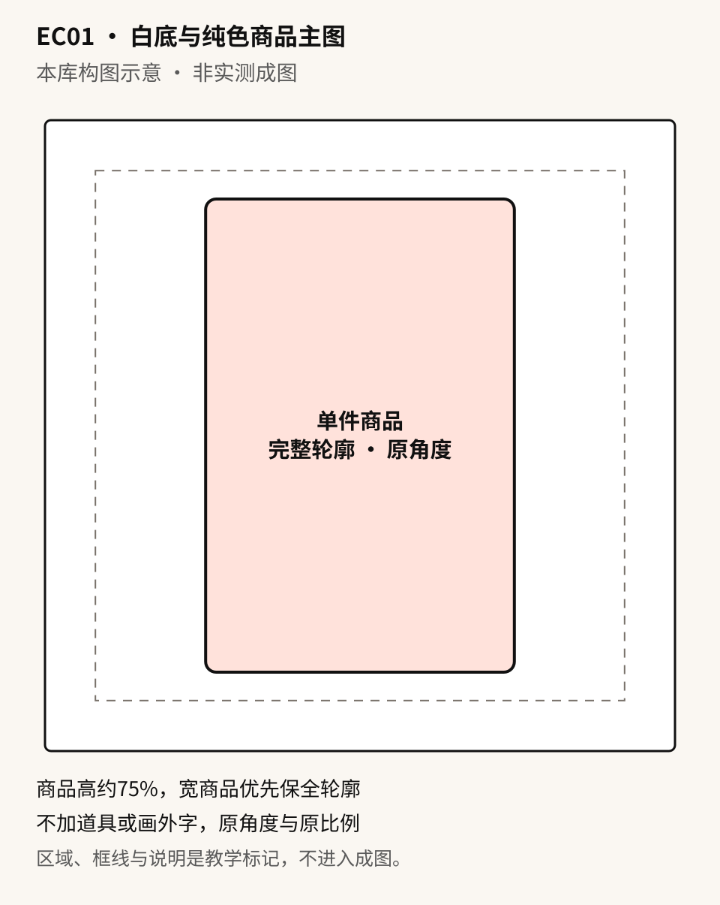
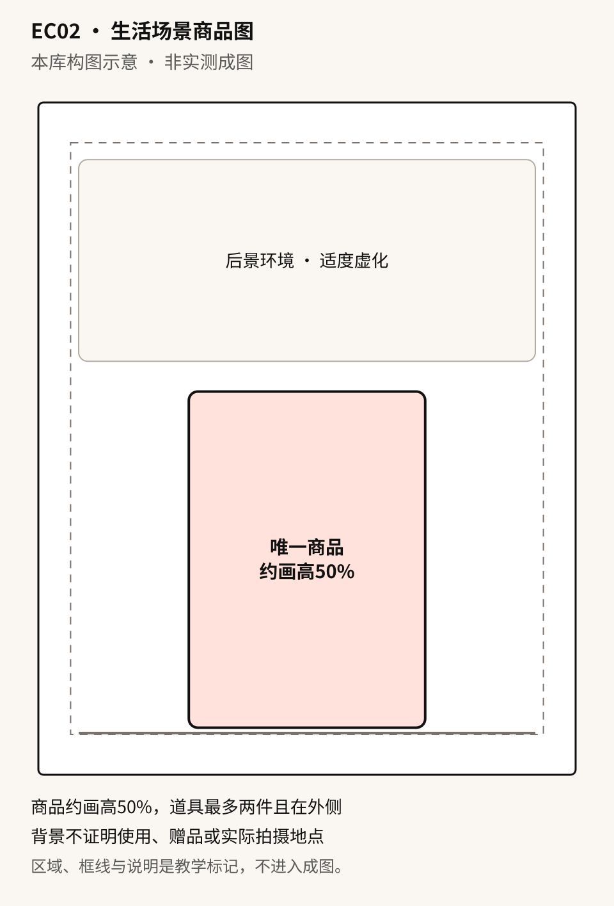
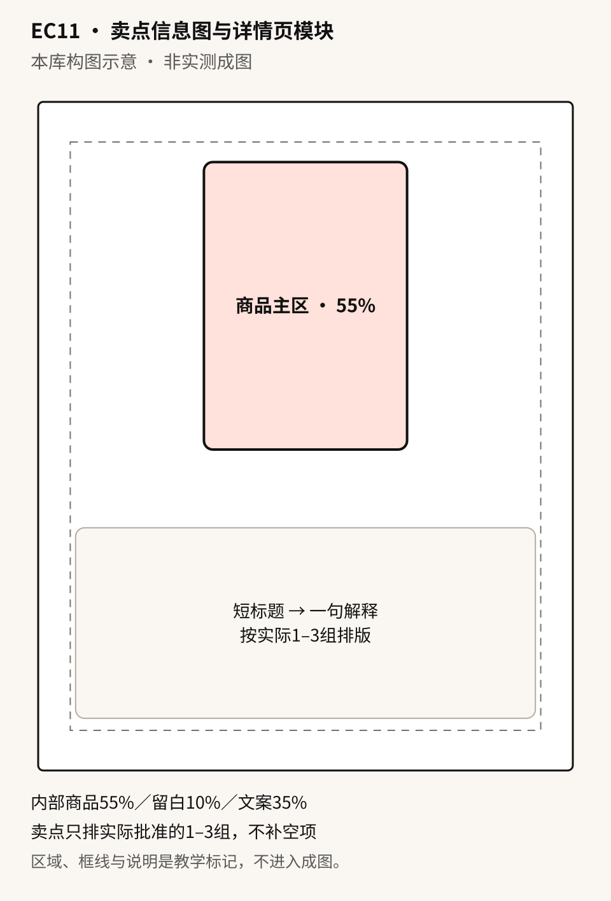
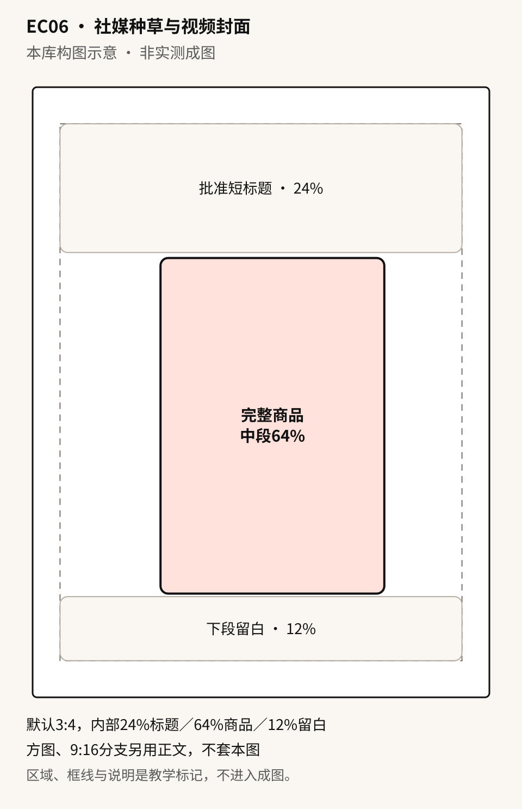
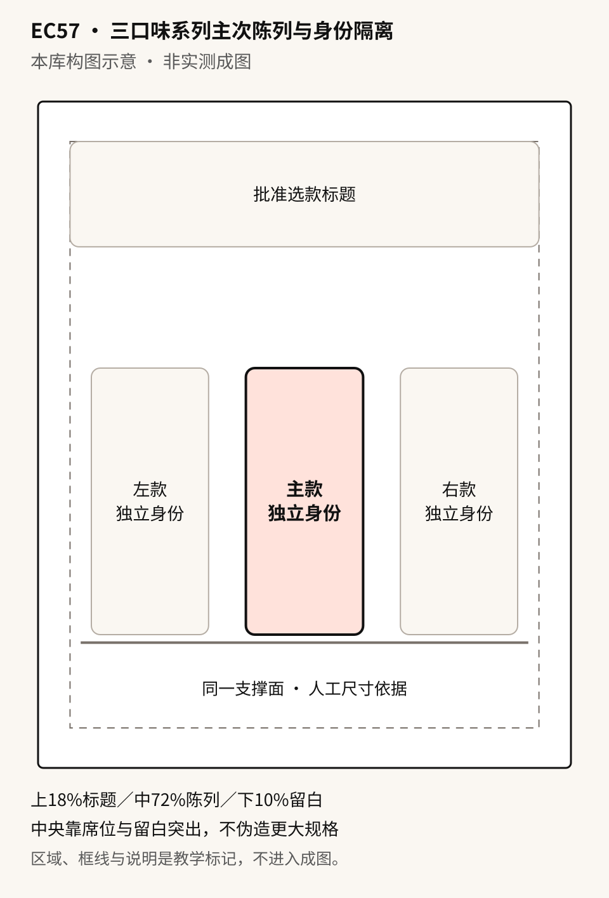
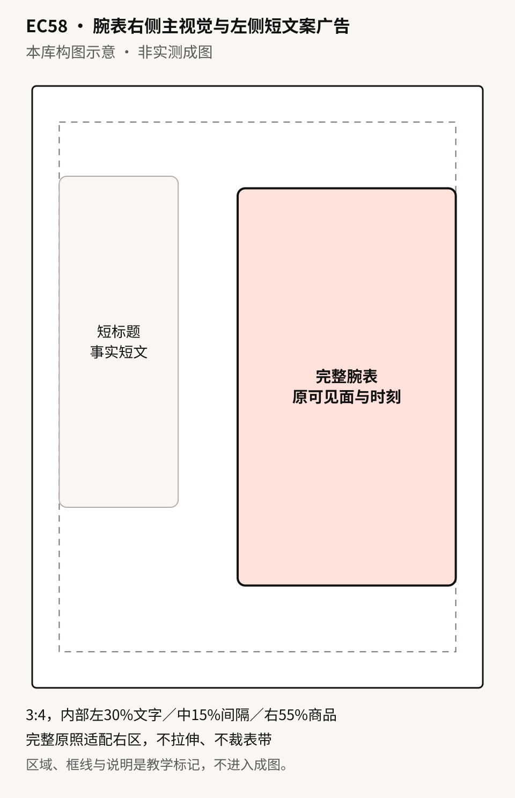
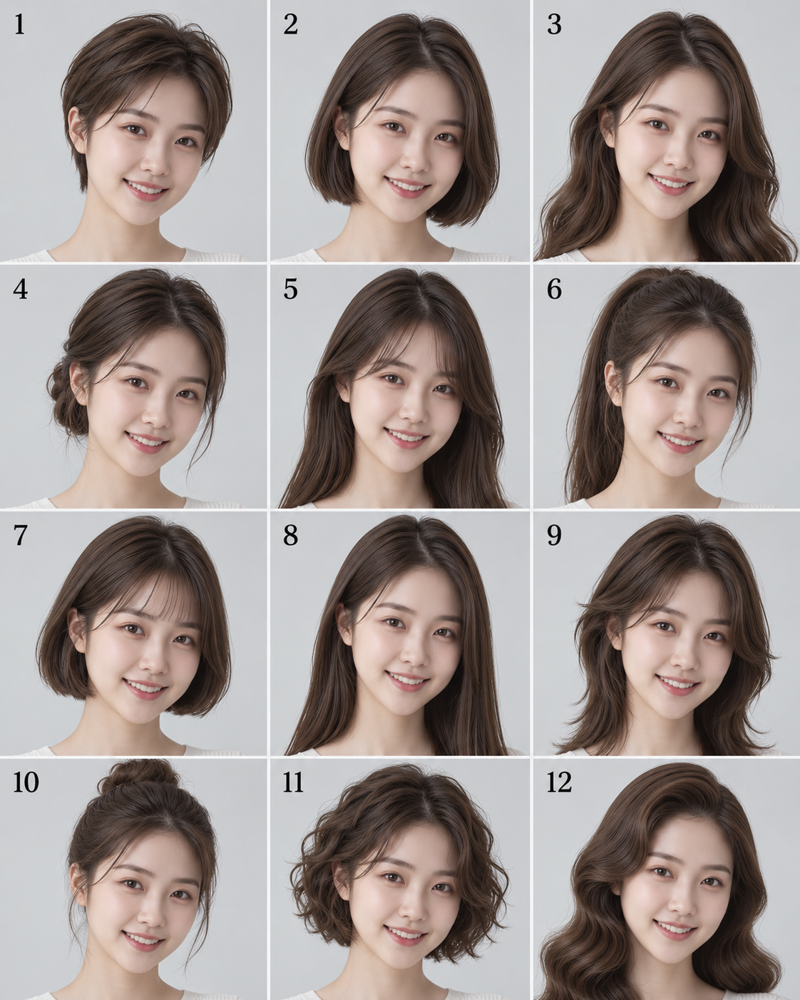

# wangge-gpt-image-2-5

[简体中文](README.md) · English

**Copy-ready prompts for GPT Image 2.5, with a focus on ecommerce and creative image editing.**

Explore 552 base prompts (91 adapted cards, 450 originals and 11 prompts developed from documented 2.5 examples), plus 155 complete variations. The collection includes 410 general templates, 65 ecommerce scenarios and 57 curated creative prompts. Ecommerce templates offer 104 variations, from clean product shots to seasonal campaigns.

New [EC64 buyer questions](prompts/ecommerce/EC64.md) and [EC65 included items versus photo props](prompts/ecommerce/EC65.md) use attributed, licensed input photos. [T35 element removal](prompts/templates/T35.md) now has complete text-only and single-image simple-background routes. Answers and delivery scope come from approved text, not image-based guesses; missing prop photos can use a text-only exclusion panel.

Previously revised [EC09 factual before/after layouts](prompts/ecommerce/EC09.md), [EC15 livestream announcements](prompts/ecommerce/EC15.md), [EC20 editorial covers](prompts/ecommerce/EC20.md) and [T24 Chinese localization](prompts/templates/T24.md) include four complete reduced-input routes. Missing evidence is not replaced with invented outcomes, contact poses or body details.

New independent tasks cover [EC62 used-item condition disclosure](prompts/ecommerce/EC62.md) and [EC63 two-category shop navigation](prompts/ecommerce/EC63.md). [EC07 candid-style advertising](prompts/ecommerce/EC07.md) now separates its single-photo still life from people and unboxing routes. [Three licensed real input photographs](ecommerce/licensed-references.md) include authors, licenses and explicit roles; they are not generated outputs. All 30 featured cards have a preview; the collection has 66 previews, including 24 original schematics. Image testing remains optional.

Eight category workflows turn the library into ordered production checklists: [beauty](ecommerce/kits/beauty.md), [apparel](ecommerce/kits/apparel.md), [food](ecommerce/kits/food.md), [home](ecommerce/kits/home.md), [digital devices](ecommerce/kits/digital.md), [small appliances](ecommerce/kits/appliance.md), [bags](ecommerce/kits/bags.md), and [baby products](ecommerce/kits/baby.md). Fill and submit one product fact sheet first, then use either the single-image minimum path or the complete-materials path. Each package provides six prompts, required references, acceptance checks, and a focused repair instruction.

Ecommerce cards EC01–EC65 include filled, copy-ready Chinese examples alongside reusable variable templates.

The gallery now starts with 30 practical image-production cards, with separate routes for product shots, scenes, detail modules, campaigns, editing and commercial creative work. Structural checks remain available separately. Product-themed templates are no longer mislabeled as non-product tasks. Recent prompt revisions preserve source angles, secondary scene props and approved detail-page claims.

[Image-production gallery](https://wangge-dev.github.io/wangge-gpt-image-2-5/browse/): choose an output route, then filter by task, product category, reference-image requirements and available results. Optional image testing does not block prompt maintenance.

[One product, three workflows](ecommerce/evolink-product-story.md): scene replacement, creator-style product imagery and localized marketing assets. Includes EvoLink-supplied examples and Chinese adaptations.

## Choose a layout, then copy the prompt

Original Chinese schematics below link to the complete prompts. These are not generated results.

| [Product shot](prompts/ecommerce/EC01.md) | [Lifestyle scene](prompts/ecommerce/EC02.md) | [Detail module](prompts/ecommerce/EC11.md) |
| --- | --- | --- |
|  |  |  |
| [Social cover](prompts/ecommerce/EC06.md) | [SKU selection](prompts/ecommerce/EC57.md) | [Watch advertisement](prompts/ecommerce/EC58.md) |
|  |  |  |

## Explore

| Create | Start here |
| --- | --- |
| Product photos, campaigns, packaging and detail pages | [Ecommerce collection](ecommerce/README.md) |
| Have product photos and need the next image | [Shortest path by available inputs](ecommerce/start-here.md) (Chinese) |
| Prepare a complete ecommerce image set | [Three sample project briefs](ecommerce/sample-projects.md) (Chinese) |
| Review source-backed prompt sets | [System76 Launch 2](ecommerce/samples/system76-launch-2.md), [a circa-1949 NIVEA tin](ecommerce/samples/nivea-creme-1949-tin.md), and [a white IKEA LACK table](ecommerce/samples/ikea-lack-white-table.md) (Chinese; all pending execution) |
| Posters, infographics, portraits, branding, spaces and interfaces | [Prompt index](prompts/README.md) |
| Hairstyle grids, enamel pins and miniature ads | [Creative gallery](gallery/README.md) |
| Copy edits, localization and consistent product series | [Original workflows](experiments/README.md) |
| Prompts based on documented 2.5 examples | [Eleven complete Chinese prompts](cases/README.md) |
| Try the three featured examples in ChatGPT | [Bilingual prompts](guides/web-examples.md) |

Most individual cards are in Chinese. The featured examples include complete English prompts.

## Featured results

Generated by wangge-dev in ChatGPT web. [Chinese and English prompts](guides/web-examples.md).

| Twelve hairstyles | Travel enamel pin | Mint rose perfume |
| --- | --- | --- |
|  |  |  |

## How to use

1. Open a prompt card and upload the reference images it calls for.
2. Replace the `{{variables}}` with your own details and approved text.
3. Paste the full prompt into ChatGPT image generation or another tool offering GPT Image 2.5.
4. To refine the result, keep your original references and use the follow-up editing prompt.

Each card includes inputs, variables, a complete prompt, suggested dimensions, editing instructions and source links. Where available, variations are provided as complete blocks ready to copy.

For ChatGPT web, describe the desired aspect ratio in the prompt. API users can configure output dimensions separately. See [model and output settings](guides/models.md).

## Ecommerce focus

Start with [clean product shots](prompts/ecommerce/EC01.md), then explore [lifestyle scenes](prompts/ecommerce/EC02.md), [promotional posters](prompts/ecommerce/EC05.md), [feature graphics](prompts/ecommerce/EC11.md), [size guides](prompts/ecommerce/EC13.md) and [seasonal campaigns](prompts/ecommerce/EC21.md).

The [product series guide](ecommerce/product-kit.md) connects these into a repeatable workflow using the same product references and brand styling.

## Updates and credits

The library grows through new prompts, useful variations and improved editing instructions. Adaptations credit their source authors and link to the original material. Gallery images are labeled as contributed results or source references; attribution is provided on each card.

[Changelog](CHANGELOG.md) · [Contribute](CONTRIBUTING.md) · [Sources and licenses](ATTRIBUTIONS.md)

Maintained by wangge-dev. This is an independent project, not affiliated with OpenAI.

New: [G32 travel-ticket paper diorama](prompts/gallery/G32.md), and [G22 six-panel campaign with six standalone prompts](prompts/gallery/G22.md). The gallery supports direct case links, link copying, image enlargement and side-by-side input/output viewing.

Ecommerce cards EC01–EC65 include explicit reference-image requirements and fully filled Chinese examples alongside their variable templates.
