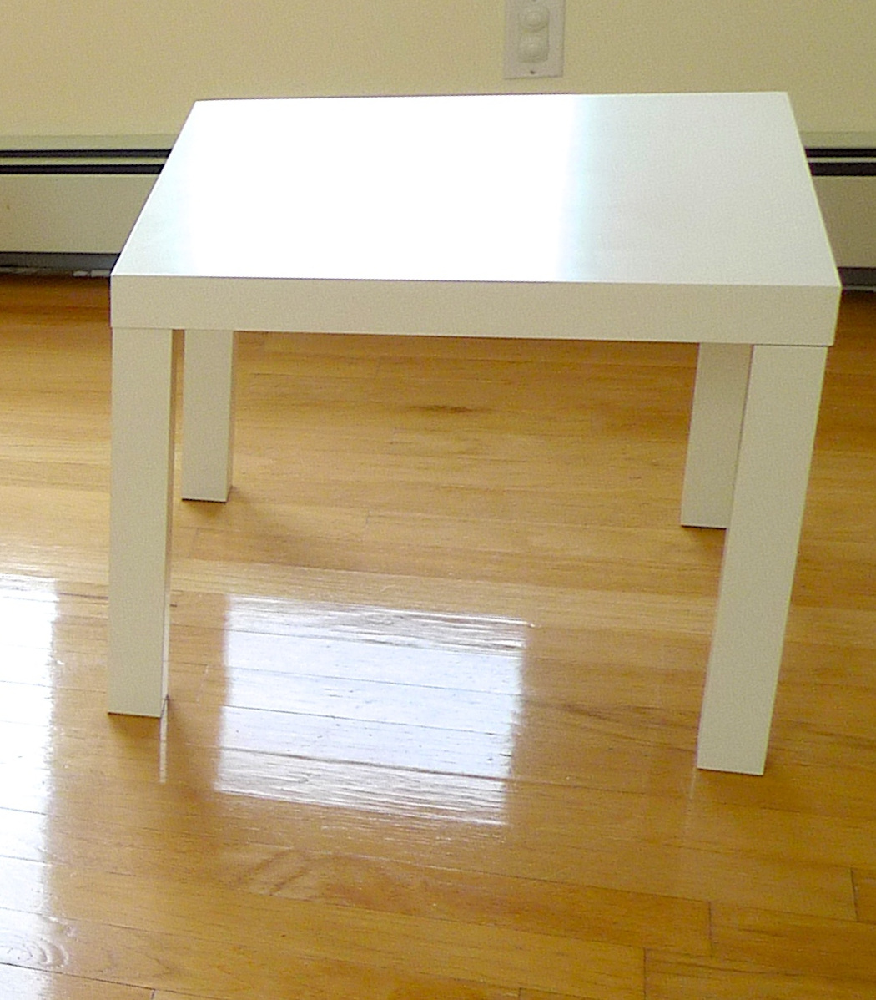
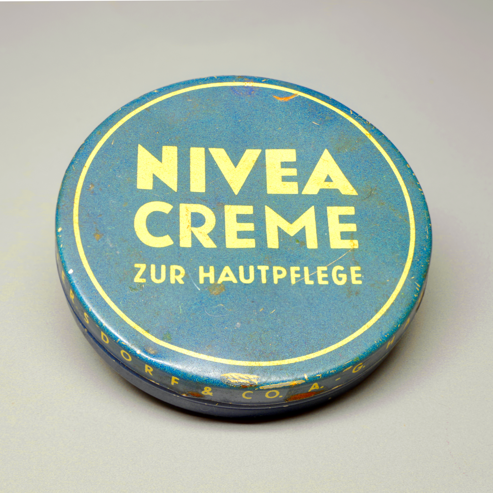
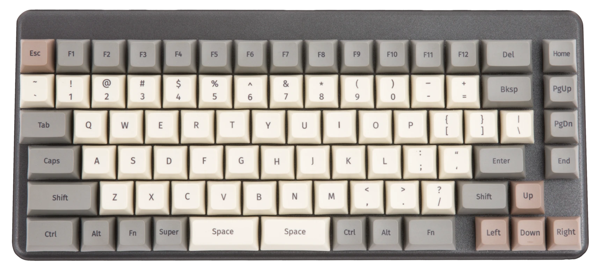
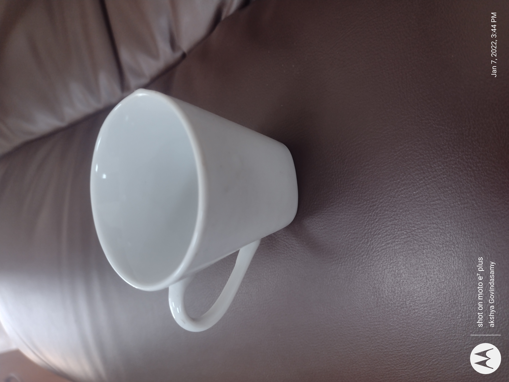

# 真实参考照片：先看职责，再准备素材

[电商专区](README.md) · [按现有素材找任务](start-here.md) · [署名与许可](../ATTRIBUTIONS.md)

下面是可公开复用的真实输入照片，不是这些中文提示词的生成结果。前三张原件沿用既有素材池；2026-11-02新增一张杯具原照，当前本页四张不同原件。三份历史执行包保留原样，不把原照数量或输入引用数算成实测。

## 白色方桌：生活随拍与品类入口

摄影：Juhan Sonin · [原始文件页](https://commons.wikimedia.org/wiki/File:IKEA_Lack.jpg) · [CC BY 2.0](https://creativecommons.org/licenses/by/2.0/)（本库采用该许可选项）。原照1050×1198，未裁切、未改色，网页仅等比缩放。

用于[EC07无人生活随拍广告](../prompts/ecommerce/EC07.md)的商品身份，以及[EC63双品类导航](../prompts/ecommerce/EC63.md)右区代表商品。只依照片可见轮廓、四腿、原视角；原背景不属于商品，不从照片推尺寸、材质、承重或现售货号。不表示IKEA认可本库或广告。

## 历史铁盒：原样成色披露

摄影：Berthold Werner · [原始文件页](https://commons.wikimedia.org/wiki/File:Nivea_Creme_BW_2025-07-05_16-51-45_s.jpg) · [CC BY-SA 4.0](https://creativecommons.org/licenses/by-sa/4.0/)。原照3989×3989，未裁切、未改色，网页仅等比缩放。

用于[EC62完整外观与原照局部披露](../prompts/ecommerce/EC62.md)。只展示闭合盒盖、原字、掉漆及可见磨损；两个局部是同一张照片的裁切，不是额外商品、微距实拍或开盒过程。历史包装例不代表在售商品、真伪鉴定、护肤效果或复刻授权。

## 键盘：独立品类代表

作者：System76 · [原始文件页](https://commons.wikimedia.org/wiki/File:S76-tech-docs_launch_2_top.webp) · [CC BY-SA 4.0](https://creativecommons.org/licenses/by-sa/4.0/)。本地原件解码1715×776，未裁切、未改色，网页仅等比缩放。

用于[EC63双品类导航](../prompts/ecommerce/EC63.md)左区。只控制键位、双空格、外壳与键帽可见外观；不从顶面推端口、协议、性能或随赠物，不暗示与方桌属于套装或两个品牌合作。

## 新任务中的不同职责（2026-10-26）

方桌原照也用于[EC64买前问答](../prompts/ecommerce/EC64.md)：只证明可见白色外观，不证明尺寸、材质或承重，待确认信息由人工声明。

键盘与方桌分别用于[EC65随售与道具排除](../prompts/ecommerce/EC65.md)的包含区／不包含区。区分来自本教学清单，不代表System76真实供货配置、两品牌合作或同场拍摄。缺道具原照可选完整文字排除分支，不生成道具。两卡是新用途，原件仍是上面已有照片，不计新增拍摄或采集；预览仍不是生成效果。

本次重读方桌文件页与两种CC许可说明；键盘网页仍无法读取，由Commons imageinfo核作者System76／CC BY-SA 4.0／1715×776。两原件已本地查看，未改色、未裁切，无新副本；历史铁盒本次未重查，沿用原核查记录。

## 杯具：活动日程说明的完整原照输入（2026-11-02）

摄影：Akshaya govindasamy · [原始文件页](https://commons.wikimedia.org/wiki/File:Coffee_cup_image.jpg) · [CC BY-SA 4.0](https://creativecommons.org/licenses/by-sa/4.0/)。原件3000×4000，保留方向元数据，未裁切、改色或移除相机／作者／日期标记；网页等比显示，原件信息见[素材卡](../assets/references/coffee-cup-image/README.md)。

用于[EC66活动阶段／参与条件](../prompts/ecommerce/EC66.md)，完整照片窗只提供杯体、左侧把手、杯口与原环境。活动阶段、时区、适用范围与条件全为人工练习文字，不代表照片作者的实际活动；不能从原照推容量、材质、安全、售价、随售物或在售SKU。照片上的拍摄日期不是活动日期。无商品图可用纯文字分支。

文件页和Commons imageinfo本日核对作者、许可及原件尺寸，已本地查看；照片不是生图结果。两张服装候选分别为叠穿及人物取景，不能作为本轮完整单衣／撑形依据，未入公开素材池。

## 公开使用时保留什么

逐图附作者、原始文件页、许可链接和改动说明。BY-SA照片的改编还须遵守适用的相同方式共享条件，不能统一改标本库MIT；本库文字与代码许可不覆盖照片。照片许可不等于商标、肖像或品牌背书授权。若需要完全不同的商业用途，应自行核对其他权利。

核查日期：2026-10-22。铁盒／方桌文件页及许可正文已重读；System76文件页网页读取失败后，使用Commons imageinfo公开接口核对作者、CC BY-SA 4.0和原件地址。照片已本地打开查看；未生图、未验证模型能否保持全部细节。
