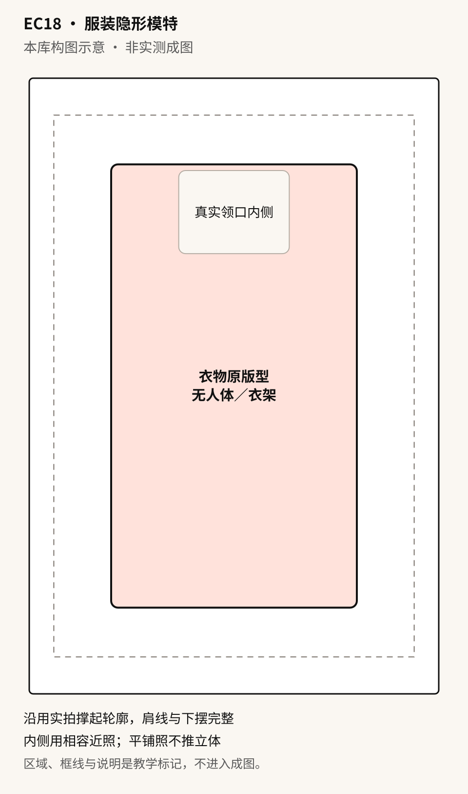

# EC18 · 服装隐形模特

[全部提示词](../README.md) · [首页](../../README.md)

**分类：商品展示 · 电商来源改写**

有真实支撑轮廓与内侧证据时整理隐形模特主图；只有平铺照时直接用不立体化的完整原照版。

## 准备材料与变量

立体版：图1必须是同款衣物已经实拍撑起的完整正面，肩胸腰与下摆外轮廓真实可见；图2只提供同款、相容机位和开合状态的内领／局部内侧，且人工确认可对应修补。不得仅用平铺照推测胸腰体积。需要开领或卷袖展示时，图1就必须拍到该状态，图2覆盖实际新露出的内侧；缺材料且另有完整单件平铺照时选“仅平铺原照”完整分支，否则先补素材，不能补造立体形态。

将下表中的值按实际任务填写，然后复制正文。示例值用于说明填写方式，不是已核实的商品事实。

| 变量 | 填写示例或说明 |
| --- | --- |
| `{{商品信息}}` | 一件已真实撑起拍摄的衬衫，颜色、缝线、纽扣、印花与图1一致，图2为同款原状态的内领局部 |
| `{{内侧依据}}` | 图2仅对应图1内领待补区域，机位与状态经人工确认相容；不提供未拍的袖内、背面或洗标 |
| `{{平铺商品信息}}` | 单件服装完整平铺原照，依图1真实颜色、褶皱、印花与可辨文字，不添加成分或尺码事实 |

## 拿来就用的具体示例

自备图1：同款衬衫已实拍撑起的完整正面，肩胸腰与下摆形态都已可见；图2：同一衬衫、相容机位的内领近照，人工确认只需小范围支撑清除且能由图2补证。没有这两张且另有完整单件平铺照时用平铺分支，不以普通平铺照代替立体依据。

按示例准备对应素材后，直接复制下段；其他商品使用后面的变量模板。

```text
制作一张2:3竖版服装商品展示图。图1是已经真实撑起的衣物正面，商品身份为一件已真实撑起拍摄的衬衫，颜色、缝线、纽扣、印花与图1一致，图2为同款原状态的内领局部；图2职责：图2仅对应图1内领待补区域，机位与状态经人工确认相容；不提供未拍的袖内、背面或洗标。图2只补获准的局部，不替换整件衣物或重设轮廓；先以图1锁肩线、胸腰宽度、袖口、下摆与所有现有褶皱，再处理背景与少量支撑清除。

完整衣物居中，四边至少8%安全区，在余下矩形内等比最大适配；宽衣优先保全袖口，不同时强定宽高、不收腰或填胸。默认白至浅灰背景，柔和光线不抹平面料。只清除已标明的可见人台／支架及其专属投影；若支撑挡住未知衣片或大片内侧而图2不能补证，暂停该区域，不重建隐藏布料。无人体、不新增衣架、手、腿、身体轮廓或配饰。

保持图1真实开合状态、纽扣数量、口袋、缝线、印花位置、颜色与可辨原字。不为展示内衬自动开扣、拉领、翻面、卷袖或改衣长。图2未覆盖的领标、洗标、里料和接缝不猜绘；深色背景与高光也不能染衣、压黑细节或改变真实面料纹理。只输出一张，不加标题、尺寸、价格、标章或新标志。立体图只是已拍形态的视觉整理，不证明真实版型、尺码或穿着效果；必须保留像素的商品区用外部原图合成。
```


## 完整提示词

```text
制作一张2:3竖版服装商品展示图。图1是已经真实撑起的衣物正面，商品身份为{{商品信息}}；图2职责：{{内侧依据}}。图2只补获准的局部，不替换整件衣物或重设轮廓；先以图1锁肩线、胸腰宽度、袖口、下摆与所有现有褶皱，再处理背景与少量支撑清除。

完整衣物居中，四边至少8%安全区，在余下矩形内等比最大适配；宽衣优先保全袖口，不同时强定宽高、不收腰或填胸。默认白至浅灰背景，柔和光线不抹平面料。只清除已标明的可见人台／支架及其专属投影；若支撑挡住未知衣片或大片内侧而图2不能补证，暂停该区域，不重建隐藏布料。无人体、不新增衣架、手、腿、身体轮廓或配饰。

保持图1真实开合状态、纽扣数量、口袋、缝线、印花位置、颜色与可辨原字。不为展示内衬自动开扣、拉领、翻面、卷袖或改衣长。图2未覆盖的领标、洗标、里料和接缝不猜绘；深色背景与高光也不能染衣、压黑细节或改变真实面料纹理。只输出一张，不加标题、尺寸、价格、标章或新标志。立体图只是已拍形态的视觉整理，不证明真实版型、尺码或穿着效果；必须保留像素的商品区用外部原图合成。
```

## 参数设置

建议画布：`1024x1536`；模型选择及格式见[模型说明](../../guides/models.md)。网页版可按相同比例描述画布。

立体主图需要真实撑起轮廓及相容内侧照片，平铺照不证明立体版型。缺内侧或真实撑起形态时，仅在另有完整单件平铺照的情况下选平铺原照版，否则补素材，不把补造立体当缺图降级；商品区需逐像素保持时用外部合成。

## 可复制变体

选择一个版本，替换变量后整段复制；每段已包含基础要求。

### 纯白干净 · white-clean

```text
制作一张2:3竖版服装商品展示图。图1是已经真实撑起的衣物正面，商品身份为{{商品信息}}；图2职责：{{内侧依据}}。图2只补获准的局部，不替换整件衣物或重设轮廓；先以图1锁肩线、胸腰宽度、袖口、下摆与所有现有褶皱，再处理背景与少量支撑清除。

完整衣物居中，四边至少8%安全区，在余下矩形内等比最大适配；宽衣优先保全袖口，不同时强定宽高、不收腰或填胸。默认白至浅灰背景，柔和光线不抹平面料。只清除已标明的可见人台／支架及其专属投影；若支撑挡住未知衣片或大片内侧而图2不能补证，暂停该区域，不重建隐藏布料。无人体、不新增衣架、手、腿、身体轮廓或配饰。

保持图1真实开合状态、纽扣数量、口袋、缝线、印花位置、颜色与可辨原字。不为展示内衬自动开扣、拉领、翻面、卷袖或改衣长。图2未覆盖的领标、洗标、里料和接缝不猜绘；深色背景与高光也不能染衣、压黑细节或改变真实面料纹理。只输出一张，不加标题、尺寸、价格、标章或新标志。立体图只是已拍形态的视觉整理，不证明真实版型、尺码或穿着效果；必须保留像素的商品区用外部原图合成。

背景使用纯白，均匀柔光，保留已有衣物层次和轻柔落影，不漂白衣料。
```

### 杂志风格 · editorial

```text
制作一张2:3竖版服装商品展示图。图1是已经真实撑起的衣物正面，商品身份为{{商品信息}}；图2职责：{{内侧依据}}。图2只补获准的局部，不替换整件衣物或重设轮廓；先以图1锁肩线、胸腰宽度、袖口、下摆与所有现有褶皱，再处理背景与少量支撑清除。

完整衣物居中，四边至少8%安全区，在余下矩形内等比最大适配；宽衣优先保全袖口，不同时强定宽高、不收腰或填胸。默认白至浅灰背景，柔和光线不抹平面料。只清除已标明的可见人台／支架及其专属投影；若支撑挡住未知衣片或大片内侧而图2不能补证，暂停该区域，不重建隐藏布料。无人体、不新增衣架、手、腿、身体轮廓或配饰。

保持图1真实开合状态、纽扣数量、口袋、缝线、印花位置、颜色与可辨原字。不为展示内衬自动开扣、拉领、翻面、卷袖或改衣长。图2未覆盖的领标、洗标、里料和接缝不猜绘；深色背景与高光也不能染衣、压黑细节或改变真实面料纹理。只输出一张，不加标题、尺寸、价格、标章或新标志。立体图只是已拍形态的视觉整理，不证明真实版型、尺码或穿着效果；必须保留像素的商品区用外部原图合成。

背景使用深灰渐变，衣物曝光与本色不变，不用浓重顶光抹掉纹理或改变体积。
```

### 展示内衬细节 · editorial-detail

```text
制作一张2:3竖版服装商品展示图。图1是已经真实撑起的衣物正面，商品身份为{{商品信息}}；图2职责：{{内侧依据}}。图2只补获准的局部，不替换整件衣物或重设轮廓；先以图1锁肩线、胸腰宽度、袖口、下摆与所有现有褶皱，再处理背景与少量支撑清除。

完整衣物居中，四边至少8%安全区，在余下矩形内等比最大适配；宽衣优先保全袖口，不同时强定宽高、不收腰或填胸。默认白至浅灰背景，柔和光线不抹平面料。只清除已标明的可见人台／支架及其专属投影；若支撑挡住未知衣片或大片内侧而图2不能补证，暂停该区域，不重建隐藏布料。无人体、不新增衣架、手、腿、身体轮廓或配饰。

保持图1真实开合状态、纽扣数量、口袋、缝线、印花位置、颜色与可辨原字。不为展示内衬自动开扣、拉领、翻面、卷袖或改衣长。图2未覆盖的领标、洗标、里料和接缝不猜绘；深色背景与高光也不能染衣、压黑细节或改变真实面料纹理。只输出一张，不加标题、尺寸、价格、标章或新标志。立体图只是已拍形态的视觉整理，不证明真实版型、尺码或穿着效果；必须保留像素的商品区用外部原图合成。

仅当图1本来已拍到开领／卷袖状态，且图2含对应内侧实拍时展示该实际区域；没有对应状态就保持闭合外观，不打开或翻折制造新内衬。
```

### 带环境道具 · lifestyle

```text
制作一张2:3竖版服装商品展示图。图1是已经真实撑起的衣物正面，商品身份为{{商品信息}}；图2职责：{{内侧依据}}。图2只补获准的局部，不替换整件衣物或重设轮廓；先以图1锁肩线、胸腰宽度、袖口、下摆与所有现有褶皱，再处理背景与少量支撑清除。

完整衣物居中，四边至少8%安全区，在余下矩形内等比最大适配；宽衣优先保全袖口，不同时强定宽高、不收腰或填胸。默认白至浅灰背景，柔和光线不抹平面料。只清除已标明的可见人台／支架及其专属投影；若支撑挡住未知衣片或大片内侧而图2不能补证，暂停该区域，不重建隐藏布料。无人体、不新增衣架、手、腿、身体轮廓或配饰。

保持图1真实开合状态、纽扣数量、口袋、缝线、印花位置、颜色与可辨原字。不为展示内衬自动开扣、拉领、翻面、卷袖或改衣长。图2未覆盖的领标、洗标、里料和接缝不猜绘；深色背景与高光也不能染衣、压黑细节或改变真实面料纹理。只输出一张，不加标题、尺寸、价格、标章或新标志。立体图只是已拍形态的视觉整理，不证明真实版型、尺码或穿着效果；必须保留像素的商品区用外部原图合成。

只有一个不接触衣物的细枝布景，位于画面右下外侧留白内、权重低于衣物；不遮袖口下摆，不形成随售赠品或穿搭关系。
```

### 仅平铺原照 · flat-photo-only

```text
只使用图1单件服装完整平铺原照，商品身份：{{平铺商品信息}}。做一张2:3竖版原照式商品展示，不做隐形模特、立体撑起、试穿、开领或翻面，不改变真实平铺轮廓、原视角、褶皱、宽长比例、袖口和下摆位置。

原照完整作为一个矩形照片窗居中，四边至少8%安全区，等比适配，不裁掉衣物、原署名或许可信息，不把照片里的背景或支撑当新商品生成。窗外纯白留白，不添加另一件衣服、身体、衣架、内衬、标签、成分、参数、价格、广告字或装饰。只保留图1原有可辨文字，不猜写模糊标签；原图没拍到的袖内、背面和洗标保持未展示。

照片窗内色彩、曝光和纹理保持原样，不美化去瑕、不重画局部、不从平面推测穿着体积。只输出一张展示图；这是平铺原照版，不是立体样衣或合身验证。若照片包含多件叠穿、遮挡或人物，本分支不能把它们剥离重建为单件，需要另备完整单件照；精确保留原像素用外部排版合成。
```

修改前，将修改指令中的双花括号内容按实际问题填写；每次只处理一个位置。

## 接着修改

上传上一轮结果；涉及商品或人物时，同时保留原始参考图。

```text
以上一轮结果为底图，重新附所用分支的原始材料：立体版附原图1与实际对应的图2，平铺版只附图1完整平铺照，不借缺失图补立体。仅修复{{批准部位}}的{{单一缺陷}}，依{{真实对应证据}}恢复；其他衣片、外轮廓、宽长比例、褶皱、开合状态、背景和原字不变。缺少被遮挡细节就暂停该局部，不扩修，不以换版型、开领或卷袖掩盖错误；只输出一张。
```

## 来源

- [buluslan/gpt-image2-ecommerce · 18-ghost-mannequin.json · 原 Image 2 模板](https://github.com/buluslan/gpt-image2-ecommerce/blob/a3673fb6f316664280e6abd90a60a578c6fb2228/references/templates/18-ghost-mannequin.json)
- [OpenAI GPT Image 2.5提示词指南 · 构图、参考职责与编辑边界](https://developers.openai.com/api/docs/guides/image-prompting)

本库构图示意 · 非实测成图



整理日期：2026-11-02。上游许可及第三方素材边界见[署名说明](../../ATTRIBUTIONS.md)。
