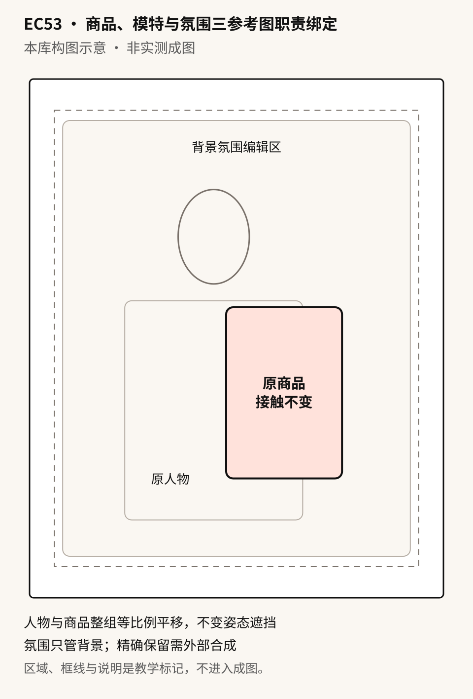

# EC53 · 商品、模特与氛围三参考图职责绑定

[全部提示词](../README.md) · [首页](../../README.md)

**分类：模特展示 · 本库原创设计**

将商品身份、真实上身关系和氛围分工，保留原实拍姿态与可见面，只改场景气氛；不把正面商品照强行变成背负角度。

## 准备材料与变量

图1：与图2同款的商品可见面照片，负责核对身份；图2：获准成年模特实际背着或持着该商品的清晰照片，负责人物、商品可见面、接触、相对大小、姿态和遮挡；图3：仅作背景色调与光线方向的氛围参考。图1与图2商品不一致先停止，不从独立人像推断背负关系。缺图3可用单张真实上身照分支。

将下表中的值按实际任务填写，然后复制正文。示例值用于说明填写方式，不是已核实的商品事实。

| 变量 | 填写示例或说明 |
| --- | --- |
| `{{商品}}` | 黑色通勤双肩包，以实际照片可见外观和人工确认的同款身份为准 |
| `{{原姿态与遮挡}}` | 保持真实上身照中背向镜头的姿态、双肩带接触和原遮挡，不露出原图未见的脸或包面 |
| `{{氛围}}` | 图3的冷灰晨光、柔和左侧光和低饱和蓝灰背景，不复制具体地标 |
| `{{背景文字说明}}` | 浅灰简洁城市入口背景，柔和左侧晨光，不出现标识、路人或新道具 |

## 拿来就用的具体示例

图1：同款黑色通勤双肩包身份照；图2：获准成年模特背向镜头、实际背着同款包的清晰上身照，包与肩带完整可见；图3：冷灰晨光氛围图。以实际照片可见面为准，不要求人物正脸。

按示例准备对应素材后，直接复制下段；其他商品使用后面的变量模板。

```text
图1只核对商品身份，不负责图2未见的角度；图2是同款商品与获准成年模特真实上身的共同依据；图3只借用图3的冷灰晨光、柔和左侧光和低饱和蓝灰背景，不复制具体地标，不带入图3的人物、商品、文字和道具。若图1与图2身份冲突，先停止并换同款材料，不混合拼凑。

图中商品为黑色通勤双肩包，以实际照片可见外观和人工确认的同款身份为准。人物与商品是一组受保护的真实上身关系：保持真实上身照中背向镜头的姿态、双肩带接触和原遮挡，不露出原图未见的脸或包面。保留人物身份、原服装、商品原角度和可见面、肩带路径、接触、相对大小、褶皱及遮挡；不翻包、不透视穿透、不为了显示前袋、标志或脸而转动人物。原图被遮住的结构继续被遮住，不能同时要求正面、背面和脸全部清楚。

制作4:5竖版场景图。四边6%为安全边距，人物与商品整组居中，整组仅等比例缩放、整体平移，四周保留背景留白；不裁掉原图已完整可见的商品轮廓，不补原图边缘以外的身体或包体。若原照太紧无法兼顾留白，先换可用实拍，不生成未知部位。先锁整组轮廓与遮挡，再改背景与柔和光线，商品本色不随背景染色。

不添加画外文案、价格、容量、防水、承重或认证，不删除包装原字。生成编辑仍须人工核对，不能保证逐像素保留；要精确保留人物商品时，用外部抠图合成背景。只输出一张完整图片。
```


## 完整提示词

```text
图1只核对商品身份，不负责图2未见的角度；图2是同款商品与获准成年模特真实上身的共同依据；图3只借用{{氛围}}，不带入图3的人物、商品、文字和道具。若图1与图2身份冲突，先停止并换同款材料，不混合拼凑。

图中商品为{{商品}}。人物与商品是一组受保护的真实上身关系：{{原姿态与遮挡}}。保留人物身份、原服装、商品原角度和可见面、肩带路径、接触、相对大小、褶皱及遮挡；不翻包、不透视穿透、不为了显示前袋、标志或脸而转动人物。原图被遮住的结构继续被遮住，不能同时要求正面、背面和脸全部清楚。

制作4:5竖版场景图。四边6%为安全边距，人物与商品整组居中，整组仅等比例缩放、整体平移，四周保留背景留白；不裁掉原图已完整可见的商品轮廓，不补原图边缘以外的身体或包体。若原照太紧无法兼顾留白，先换可用实拍，不生成未知部位。先锁整组轮廓与遮挡，再改背景与柔和光线，商品本色不随背景染色。

不添加画外文案、价格、容量、防水、承重或认证，不删除包装原字。生成编辑仍须人工核对，不能保证逐像素保留；要精确保留人物商品时，用外部抠图合成背景。只输出一张完整图片。
```

## 参数设置

建议画布：`1536x1920`；模型选择及格式见[模型说明](../../guides/models.md)。网页版可按相同比例描述画布。

基础版要求真实同款上身照，不把独立正面商品图+人像当已知背负关系。缺氛围图用单张真实上身照完整分支；没有真实关系照片则暂不执行本卡，若只需概念持握按EC08条件处理。

## 可复制变体

选择一个版本，替换变量后整段复制；每段已包含基础要求。

### 单张真实上身照 · single-worn-photo

```text
只上传图1：获准成年模特与同款商品的真实上身照；不需要独立商品照或氛围图。图1同时负责人物和商品身份、原姿态、接触与遮挡，不从文字补不可见结构。图中商品为{{商品}}。人物与商品是一组受保护的真实上身关系：{{原姿态与遮挡}}。保留人物身份、原服装、商品原角度和可见面、肩带路径、接触、相对大小、褶皱及遮挡；不翻包、不透视穿透、不为了显示前袋、标志或脸而转动人物。原图被遮住的结构继续被遮住，不能同时要求正面、背面和脸全部清楚。

制作4:5竖版场景图。四边6%为安全边距，人物与商品整组居中，整组仅等比例缩放、整体平移，四周保留背景留白；不裁掉原图已完整可见的商品轮廓，不补原图边缘以外的身体或包体。若原照太紧无法兼顾留白，先换可用实拍，不生成未知部位。先锁整组轮廓与遮挡，再改背景与柔和光线，商品本色不随背景染色。背景仅按文字“{{背景文字说明}}”设计，不调用不存在的其他参考图；新背景不表示实际拍摄地点。

不添加画外文案、价格、容量、防水、承重或认证，不删除包装原字。生成编辑仍须人工核对，不能保证逐像素保留；要精确保留人物商品时，用外部抠图合成背景。只输出一张完整图片。
```

修改前，将修改指令中的双花括号内容按实际问题填写；每次只处理一个位置。

## 接着修改

上传上一轮结果；涉及商品或人物时，同时保留原始参考图。

```text
重新附原真实上身照与当前底图，只修改{{背景的一处位置或光色}}为{{批准修正}}；不修改人物商品组的姿态、角度、接触、比例和遮挡，不转向补标签。若背景修改影响组内结构，放弃该稿回原底图；需要像素级保留则外部合成。只输出一张。
```

## 来源

- [官方 GPT Image 2.5 提示词指南](https://developers.openai.com/api/docs/guides/image-prompting)
- [GPT Image 2.5 提示词指南（公开二次整理）](https://gptimage2-5.art/blog/gpt-image-2-5-prompt-guide)

本库构图示意 · 非实测成图



整理日期：2026-10-19。上游许可及第三方素材边界见[署名说明](../../ATTRIBUTIONS.md)。
