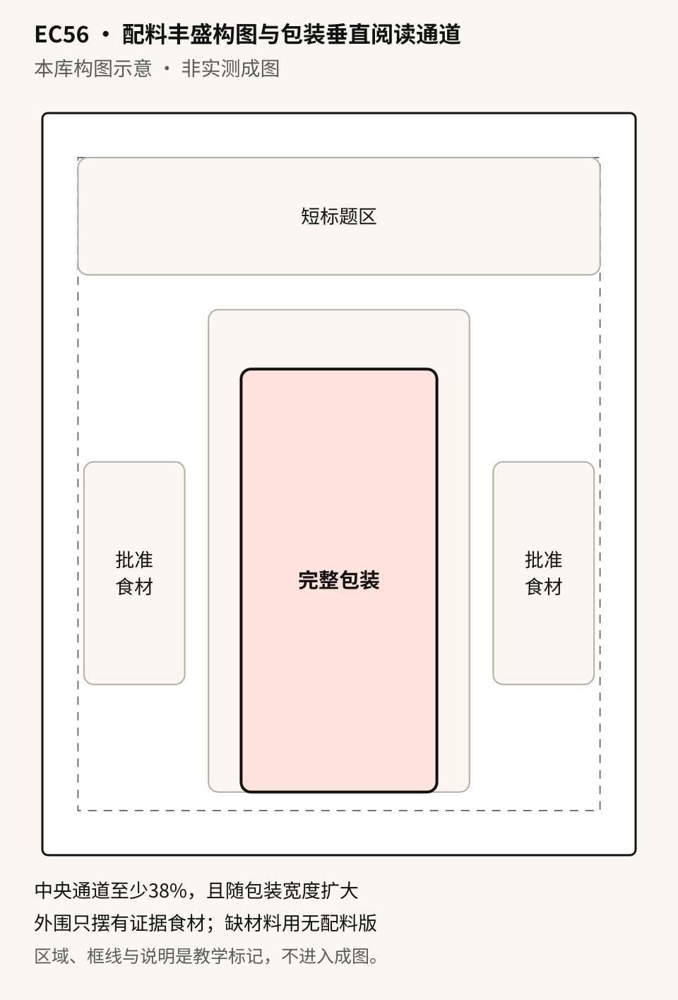

# EC56 · 配料丰盛构图与包装垂直阅读通道

[全部提示词](../README.md) · [首页](../../README.md)

**分类：场景图 · GPT Image 2.5 社区案例改写**

将有证据的配料留在包装外缘，中央通道随真实包装宽度避让；没有配料材料时可单图做干净包装广告。

## 准备材料与变量

基础版图1：完整包装原角度照；图2：人工确认属本SKU的配料清单与实拍板，逐项标明名称、数量、位置；可选图3仅作同SKU标签近照，可选色板只管背景。没有配料证据时使用单图无配料分支，不把口味名或包装插画当配方。标题、配色用文字提供，不占图片序号。

将下表中的值按实际任务填写，然后复制正文。示例值用于说明填写方式，不是已核实的商品事实。

| 变量 | 填写示例或说明 |
| --- | --- |
| `{{商品}}` | 莓果谷物袋，以图1实际袋型、封边、标志与可见原字为准 |
| `{{配料清单}}` | 人工确认：草莓两颗放左下，蓝莓五颗放右下，燕麦片一小撮放左侧，南瓜籽一小撮放右侧；均由实拍板逐项对应，仅为填写示例 |
| `{{标题}}` | 看清每一袋 |
| `{{配色}}` | 奶油白背景，莓果红小面积点缀，商品不被染色 |

## 拿来就用的具体示例

图1：莓果谷物封闭包装完整照；图2：该SKU人工确认的四种配料实拍板与批准数量／摆位，标题用文字提供。配料清单是填写演示，实际使用换成自己的证据。

按示例准备对应素材后，直接复制下段；其他商品使用后面的变量模板。

```text
商品为莓果谷物袋，以图1实际袋型、封边、标志与可见原字为准。图1控制唯一包装的原角度、轮廓、颜色、封边、原字、标志与开合状态，不补背面或内部。包装只整体等比例缩放，不能为满足占比拉伸或裁切。

制作4:5单张食品广告，四边6%安全边距；安全区顶部18%为标题，余下82%为完整包装与外围布景。包装居中偏下，目标高度约画高58%；中央保护通道至少画宽38%，还必须包住包装完整外接框并左右各留画宽3%间距，包装较宽时扩大通道并缩减外缘布景，不挤包装。通道只禁布景进入，包装本身位于通道内。阅读顺序标题、包装、外围；标题与包装不交叠。

图2只负责人工确认的配料及可见外观，清单为人工确认：草莓两颗放左下，蓝莓五颗放右下，燕麦片一小撮放左侧，南瓜籽一小撮放右侧；均由实拍板逐项对应，仅为填写示例；批准摆位须在保护通道外、标题区下方，冲突时先减少布景或改清单。只有清单、没有对应实拍的食材不画，不凭包装插画推配料。不要求模型推真实食材尺寸；需精确比例则先提供人工尺寸关系，否则仅作排版示意，不能暗示实际配比。可选标签近照只核图1已可见文字，不搬未知面的字，不复制第二袋。

标题只写“看清每一袋”一次，空项省略；配色奶油白背景，莓果红小面积点缀，商品不被染色，柔和侧光、短接触阴影。保留包装原字，模糊字不猜补。不得新增配料、奶液、蜂蜜、碗、谷穗、功效、营养数值、价格、认证或产地。成片不证明含量、比例、食品效果或实际份量。只输出一张，不生成配方表或多格板。
```


## 完整提示词

```text
商品为{{商品}}。图1控制唯一包装的原角度、轮廓、颜色、封边、原字、标志与开合状态，不补背面或内部。包装只整体等比例缩放，不能为满足占比拉伸或裁切。

制作4:5单张食品广告，四边6%安全边距；安全区顶部18%为标题，余下82%为完整包装与外围布景。包装居中偏下，目标高度约画高58%；中央保护通道至少画宽38%，还必须包住包装完整外接框并左右各留画宽3%间距，包装较宽时扩大通道并缩减外缘布景，不挤包装。通道只禁布景进入，包装本身位于通道内。阅读顺序标题、包装、外围；标题与包装不交叠。

图2只负责人工确认的配料及可见外观，清单为{{配料清单}}；批准摆位须在保护通道外、标题区下方，冲突时先减少布景或改清单。只有清单、没有对应实拍的食材不画，不凭包装插画推配料。不要求模型推真实食材尺寸；需精确比例则先提供人工尺寸关系，否则仅作排版示意，不能暗示实际配比。可选标签近照只核图1已可见文字，不搬未知面的字，不复制第二袋。

标题只写“{{标题}}”一次，空项省略；配色{{配色}}，柔和侧光、短接触阴影。保留包装原字，模糊字不猜补。不得新增配料、奶液、蜂蜜、碗、谷穗、功效、营养数值、价格、认证或产地。成片不证明含量、比例、食品效果或实际份量。只输出一张，不生成配方表或多格板。
```

## 参数设置

建议画布：`1536x1920`；模型选择及格式见[模型说明](../../guides/models.md)。网页版可按相同比例描述画布。

外围配料用于视觉表达，不能代替配方表或含量证明；发布前核对包装文字、配料真实性与平台规则。

## 可复制变体

选择一个版本，替换变量后整段复制；每段已包含基础要求。

### 单图无配料 · single-pouch-no-ingredients

```text
商品为{{商品}}。图1控制唯一包装的原角度、轮廓、颜色、封边、原字、标志与开合状态，不补背面或内部。包装只整体等比例缩放，不能为满足占比拉伸或裁切。

只上传图1，不需要配料板、色板或标签近照；仅保留图1可读原字。制作4:5单张食品广告，四边6%安全边距；安全区顶部18%为标题，余下82%为完整包装与外围布景。包装居中偏下，目标高度约画高58%；中央保护通道至少画宽38%，还必须包住包装完整外接框并左右各留画宽3%间距，包装较宽时扩大通道并缩减外缘布景，不挤包装。通道只禁布景进入，包装本身位于通道内。阅读顺序标题、包装、外围；标题与包装不交叠。外缘留成干净背景，不留假食材框、占位碗或空配方标签；不引用配料清单，不从文字添加食材。

标题只写“{{标题}}”一次，空项省略；配色{{配色}}，柔和侧光、短接触阴影。保留包装原字，模糊字不猜补。不得新增配料、奶液、蜂蜜、碗、谷穗、功效、营养数值、价格、认证或产地。成片不证明含量、比例、食品效果或实际份量。只输出一张，不生成配方表或多格板。
```

修改前，将修改指令中的双花括号内容按实际问题填写；每次只处理一个位置。

## 接着修改

上传上一轮结果；涉及商品或人物时，同时保留原始参考图。

```text
只改{{一种已批准配料的位置或数量}}，保护通道与完整包装不动；不能为避让而缩窄包装、裁标签或添加新食材。没有该食材证据先删去而非重绘补证据；其余区域保持，精确保留用外部合成。只输出一张。
```

## 来源

- [官方 GPT Image 2.5 提示词指南](https://developers.openai.com/api/docs/guides/image-prompting)
- [AtlasCloud GPT Image 2.5 Prompts · 配料环绕产品 · Loriel.AI](https://github.com/AtlasCloudAI/awesome-gpt-image-2.5-prompts/blob/6c9f79d29082c083b94804a52991d36b1295d5b0/data/prompts_by_locale/zh.json)
- [原作者帖](https://x.com/ou_zhen599/status/2097657520555008058)

本库构图示意 · 非实测成图



整理日期：2026-10-22。上游许可及第三方素材边界见[署名说明](../../ATTRIBUTIONS.md)。
