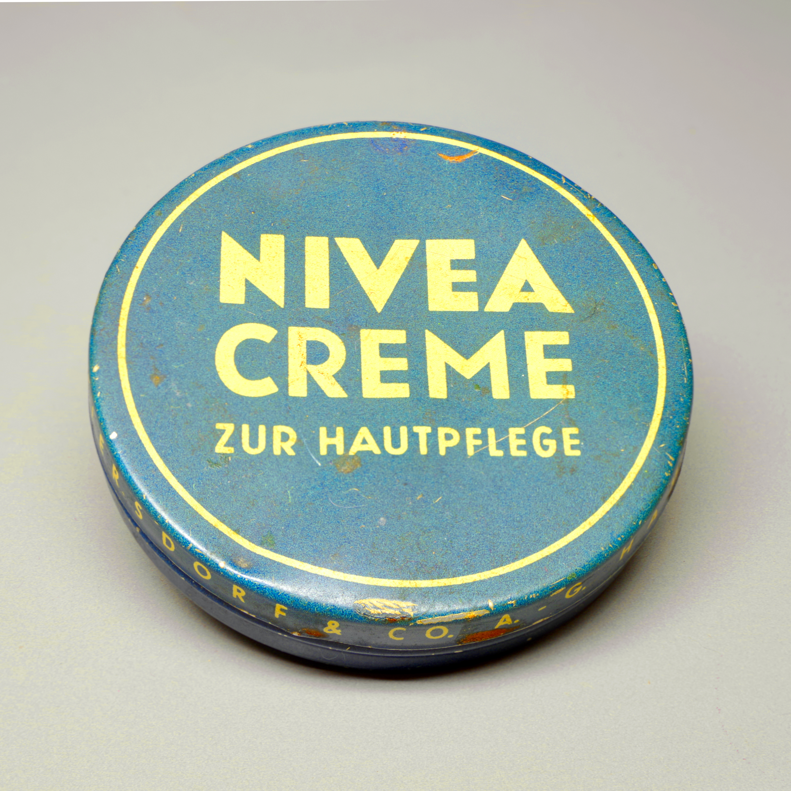

# EC62 · 中古商品成色披露与原照局部详情

[全部提示词](../README.md) · [首页](../../README.md)

**分类：高频电商成片 · 本库原创设计 · 面向 GPT Image 2.5**

把一件实际商品的完整外观和人工指定的可见磨损排成一张成色披露详情图；不美化成新品，也不把看不到的部分判成无瑕。

## 准备材料与变量

图1为该件商品的完整原照；文字提供两个已人工查看的区域和准确说明。可选同件局部照片必须先确认位置并重新编号；本卡默认只裁图1，不需要图2。没有可读局部时只保留整体原照及已确认文字，不生成细节。

将下表中的值按实际任务填写，然后复制正文。示例值用于说明填写方式，不是已核实的商品事实。

| 变量 | 填写示例或说明 |
| --- | --- |
| `{{商品}}` | 照片中的闭合 NIVEA Creme 历史铁盒，仅作为旧物成色排版教学，不代表出售或品牌授权 |
| `{{标题}}` | 实物外观记录 |
| `{{局部甲}}` | 图1盒盖上缘约12点方向、黄色外圈附近的可见掉漆，裁切时保留外圈作定位；仅标“上缘掉漆” |
| `{{局部乙}}` | 图1下缘正中、盒身前缘可见磨损与锈色区域，保留盒盖与侧壁边界；仅标“下缘磨损” |
| `{{边界说明}}` | 仅记录照片可见部分 |

## 拿来就用的具体示例

只上传已公开授权的历史铁盒原照 assets/samples/nivea-creme-1949-tin/source.jpg；本例两个位置已按原照查看。照片由 Berthold Werner 拍摄，CC BY-SA 4.0；不是在售广告。

按示例准备对应素材后，直接复制下段；其他商品使用后面的变量模板。

```text
制作一张4:5中古商品成色披露详情图。对象：照片中的闭合 NIVEA Creme 历史铁盒，仅作为旧物成色排版教学，不代表出售或品牌授权。图1是完整外观和成色的唯一事实来源；两个局部只是同一件商品的裁切重复，不代表多件、多个角度或另拍微距。

四周留5%安全区。标题区占可用高度10%，中部整体原照区占52%，下部两个等宽局部窗占28%，底部说明区占10%。完整照片等比例放入中部，商品不得被裁断；下部左窗使用“图1盒盖上缘约12点方向、黄色外圈附近的可见掉漆，裁切时保留外圈作定位；仅标“上缘掉漆””，右窗使用“图1下缘正中、盒身前缘可见磨损与锈色区域，保留盒盖与侧壁边界；仅标“下缘磨损””。先读标题，再看完整外观，最后由左至右看局部；局部可读像素不足时取消对应窗、让整体区扩展，不补纹理、不把整图模糊区域重绘成清楚细节。

标题只写“实物外观记录”，局部短标签只用人工清单中的引号文字，底部只写“仅记录照片可见部分”，每项一次。中性米白背景与深灰文字，标签在照片外，不盖住瑕疵；照片内部保持原色、原阴影、磨损位置和文字，不磨皮、除锈、去划痕、重打光、随机仿旧或补未知底面。缺失信息不写“完好”“无修复”“九成新”“保真”等评级或鉴定，不加价格、功效、销量、交易证明和品牌背书。文字放不下先停该区并转外部排字，原照像素需精确保留时直接外部图层排版。只输出一张详情图。
```


## 完整提示词

```text
制作一张4:5中古商品成色披露详情图。对象：{{商品}}。图1是完整外观和成色的唯一事实来源；两个局部只是同一件商品的裁切重复，不代表多件、多个角度或另拍微距。

四周留5%安全区。标题区占可用高度10%，中部整体原照区占52%，下部两个等宽局部窗占28%，底部说明区占10%。完整照片等比例放入中部，商品不得被裁断；下部左窗使用“{{局部甲}}”，右窗使用“{{局部乙}}”。先读标题，再看完整外观，最后由左至右看局部；局部可读像素不足时取消对应窗、让整体区扩展，不补纹理、不把整图模糊区域重绘成清楚细节。

标题只写“{{标题}}”，局部短标签只用人工清单中的引号文字，底部只写“{{边界说明}}”，每项一次。中性米白背景与深灰文字，标签在照片外，不盖住瑕疵；照片内部保持原色、原阴影、磨损位置和文字，不磨皮、除锈、去划痕、重打光、随机仿旧或补未知底面。缺失信息不写“完好”“无修复”“九成新”“保真”等评级或鉴定，不加价格、功效、销量、交易证明和品牌背书。文字放不下先停该区并转外部排字，原照像素需精确保留时直接外部图层排版。只输出一张详情图。
```

## 参数设置

建议画布：`1536x1920`；模型选择及格式见[模型说明](../../guides/models.md)。网页版可按相同比例描述画布。

这是面向买家理解的成色披露成片，不是T330跨视角瑕疵核对板。仅有一张图时不证明整件无其他问题；历史铁盒例不提供商品鉴定、功效或在售结论。原照和改编图的署名、许可及改动说明须另附，不能把CC照片改标本库MIT。


修改前，将修改指令中的双花括号内容按实际问题填写；每次只处理一个位置。

## 接着修改

上传上一轮结果；涉及商品或人物时，同时保留原始参考图。

```text
只恢复{{整体区或一个局部窗}}中被误修掉的{{原照可见磨损}}，对应图1原位置；其余照片区、标题、标签、版式与色彩不变。瑕疵需要像素级保留时停止生成式修复，改用原照片外部排版。
```

## 来源

- [OpenAI GPT Image 2.5 提示词指南 · 构图、参考职责与局部编辑](https://developers.openai.com/api/docs/guides/image-prompting)
- [Berthold Werner · 历史铁盒原照及许可](https://commons.wikimedia.org/wiki/File:Nivea_Creme_BW_2025-07-05_16-51-45_s.jpg)

### 真实输入参考 · 历史铁盒原照



摄影／作者：Berthold Werner · [CC BY-SA 4.0](https://creativecommons.org/licenses/by-sa/4.0/) · [原始文件页](https://commons.wikimedia.org/wiki/File:Nivea_Creme_BW_2025-07-05_16-51-45_s.jpg)。

只负责闭合盒盖的原字、旧漆与可见磨损；不证明内部、功效、等级或在售状态。

复用已收录原文件，未裁切、未改色；网页等比缩放。

许可核查：2026-10-22。这是输入素材，不是本卡生成效果；照片及其改编不自动适用本库MIT，公开改编须保留署名、许可和改动说明，并遵守适用的相同方式共享条件。

整理日期：2026-10-22。上游许可及第三方素材边界见[署名说明](../../ATTRIBUTIONS.md)。
