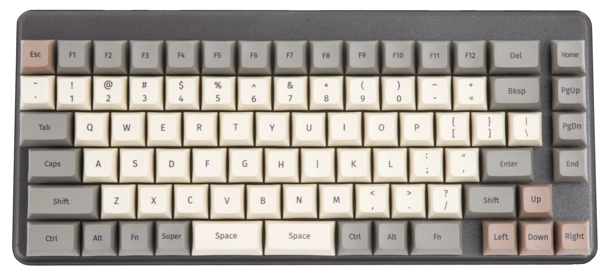
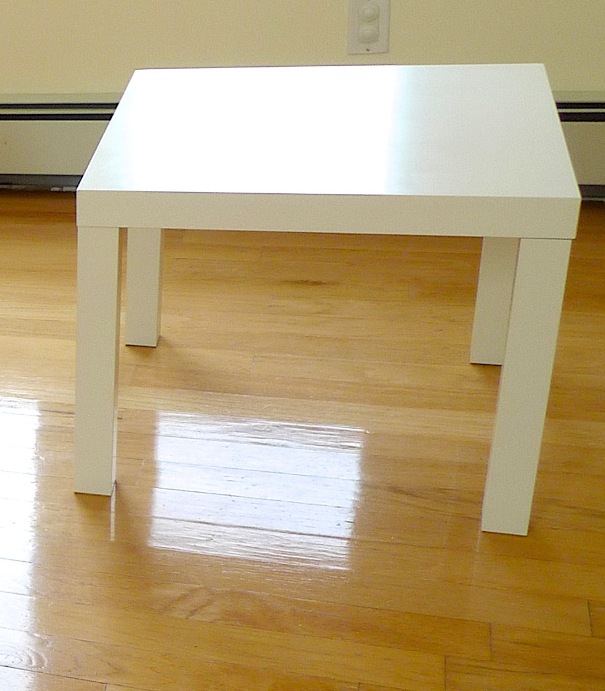

# EC63 · 店铺双品类导航横幅与独立选购区

[全部提示词](../README.md) · [首页](../../README.md)

**分类：高频电商成片 · 本库原创设计 · 面向 GPT Image 2.5**

为店铺首页制作两个彼此独立的品类入口，每区绑定各自商品、标题和按钮；不是套装、跨品类尺寸对比或同框生活场景。

## 准备材料与变量

图1为左品类代表商品原照，图2为右品类代表商品原照；文字提供两组审定类目名称、按钮字样和左右顺序。导航链接和热区在店铺装修工具中另配，本图不生成可点击功能。只有一张商品照时先补第二类原照或改用EC49单品主图，不复制商品凑两个品类。

将下表中的值按实际任务填写，然后复制正文。示例值用于说明填写方式，不是已核实的商品事实。

| 变量 | 填写示例或说明 |
| --- | --- |
| `{{左品类}}` | 数码配件 |
| `{{左商品}}` | 图1 System76 Launch 2 键盘，只用顶面可见外观 |
| `{{右品类}}` | 家居小件 |
| `{{右商品}}` | 图2 白色 IKEA LACK 方桌，只用原照片可见轮廓，不写现售参数 |
| `{{按钮}}` | 查看分类 |
| `{{视觉}}` | 米白底、深灰字、细灰分隔线；不加商标墙、促销价和跨品牌联名标志 |

## 拿来就用的具体示例

上传图1 assets/samples/system76-launch-2/top.webp（System76，CC BY-SA 4.0）与图2 assets/samples/ikea-lack-white-table/source.jpg（Juhan Sonin，CC BY 2.0）。这是混合品类导航练习，不表示两品牌合作、同套出售或真实店铺上架；两图均为输入参考。

按示例准备对应素材后，直接复制下段；其他商品使用后面的变量模板。

```text
制作一张2:1店铺双品类导航横幅。图1只对应左侧“数码配件”的图1 System76 Launch 2 键盘，只用顶面可见外观；图2只对应右侧“家居小件”的图2 白色 IKEA LACK 方桌，只用原照片可见轮廓，不写现售参数。两图不互换颜色、文字、零件或角度，不把右侧商品当左侧附件，不把两个品牌写成合作方。

四周5%安全区，可用宽度按左47%、中隔6%、右47%分区。每区上部20%排类目标题，中部60%放唯一一件代表商品，下部20%排相同按钮文字“查看分类”。商品按各自原比例完整适配中部，不裁掉腿、键盘边缘或识别锚点；两区图像尺度分别为识别服务，不暗示实物同大，不跨中隔、互相遮挡或制造同一空间透视。原图背景可留在独立照片窗里，未拍部分不补出。阅读先左后右，每区先标题再商品最后按钮。

视觉执行“米白底、深灰字、细灰分隔线；不加商标墙、促销价和跨品牌联名标志”。标题只写“数码配件”和“家居小件”，每区一次，按钮文字每区一次；按钮留在各自下部中心，不能合并成一个跨区按钮。不加页面导航栏、商品价格、库存、优惠规则、虚假跳转地址、二维码、好评或性能徽章。图像模型只输出一张平面横幅，不产生真实链接或装修文件；点击热区按左右卡区由人工在店铺后台另设，发布前检查移动端缩放可读性，字号不足用单列重排或外部排版，不硬缩字。
```


## 完整提示词

```text
制作一张2:1店铺双品类导航横幅。图1只对应左侧“{{左品类}}”的{{左商品}}；图2只对应右侧“{{右品类}}”的{{右商品}}。两图不互换颜色、文字、零件或角度，不把右侧商品当左侧附件，不把两个品牌写成合作方。

四周5%安全区，可用宽度按左47%、中隔6%、右47%分区。每区上部20%排类目标题，中部60%放唯一一件代表商品，下部20%排相同按钮文字“{{按钮}}”。商品按各自原比例完整适配中部，不裁掉腿、键盘边缘或识别锚点；两区图像尺度分别为识别服务，不暗示实物同大，不跨中隔、互相遮挡或制造同一空间透视。原图背景可留在独立照片窗里，未拍部分不补出。阅读先左后右，每区先标题再商品最后按钮。

视觉执行“{{视觉}}”。标题只写“{{左品类}}”和“{{右品类}}”，每区一次，按钮文字每区一次；按钮留在各自下部中心，不能合并成一个跨区按钮。不加页面导航栏、商品价格、库存、优惠规则、虚假跳转地址、二维码、好评或性能徽章。图像模型只输出一张平面横幅，不产生真实链接或装修文件；点击热区按左右卡区由人工在店铺后台另设，发布前检查移动端缩放可读性，字号不足用单列重排或外部排版，不硬缩字。
```

## 参数设置

建议画布：`1536x768`；模型选择及格式见[模型说明](../../guides/models.md)。网页版可按相同比例描述画布。

与EC14套装陈列、EC57同系列选款不同，本卡交付两个独立选购入口。按钮只是图面，不可点击；不实现账号、支付或店铺功能。参考照片授权不等于商标联名背书；公开改编时须履行各图署名和许可，涉及BY-SA素材时遵守其相同方式共享要求。


修改前，将修改指令中的双花括号内容按实际问题填写；每次只处理一个位置。

## 接着修改

上传上一轮结果；涉及商品或人物时，同时保留原始参考图。

```text
只修正{{左区或右区}}的{{商品归属、标题或按钮位置}}，按该区原照恢复，不修改另一侧商品、中央间隔、画幅或文字。不能用移动整套横幅来补单区错误。
```

## 来源

- [OpenAI GPT Image 2.5 提示词指南 · 构图、参考职责与局部编辑](https://developers.openai.com/api/docs/guides/image-prompting)
- [System76 · Launch 2 顶面原照及许可](https://commons.wikimedia.org/wiki/File:S76-tech-docs_launch_2_top.webp)
- [Juhan Sonin · IKEA LACK 原照及许可](https://commons.wikimedia.org/wiki/File:IKEA_Lack.jpg)

### 真实输入参考 · Launch 2 键盘原照



摄影／作者：System76 · [CC BY-SA 4.0](https://creativecommons.org/licenses/by-sa/4.0/) · [原始文件页](https://commons.wikimedia.org/wiki/File:S76-tech-docs_launch_2_top.webp)。

只负责该键盘顶面、键位、键帽颜色与双空格可见外观；不借此推端口、协议、性能或附送物。

复用已收录原文件，未裁切、未改色；网页等比缩放。

许可核查：2026-10-22。这是输入素材，不是本卡生成效果；照片及其改编不自动适用本库MIT，公开改编须保留署名、许可和改动说明，并遵守适用的相同方式共享条件。

### 真实输入参考 · 白色方桌原照



摄影／作者：Juhan Sonin · [CC BY 2.0](https://creativecommons.org/licenses/by/2.0/) · [原始文件页](https://commons.wikimedia.org/wiki/File:IKEA_Lack.jpg)。

只负责照片中白色方桌的可见轮廓、四腿及原视角；不证明现售型号、尺寸、材料或承重。

复用已收录原文件，未裁切、未改色；网页等比缩放。

许可核查：2026-10-22。这是输入素材，不是本卡生成效果；照片及其改编不自动适用本库MIT，公开改编须保留署名、许可和改动说明，并遵守适用的相同方式共享条件。

整理日期：2026-10-22。上游许可及第三方素材边界见[署名说明](../../ATTRIBUTIONS.md)。
