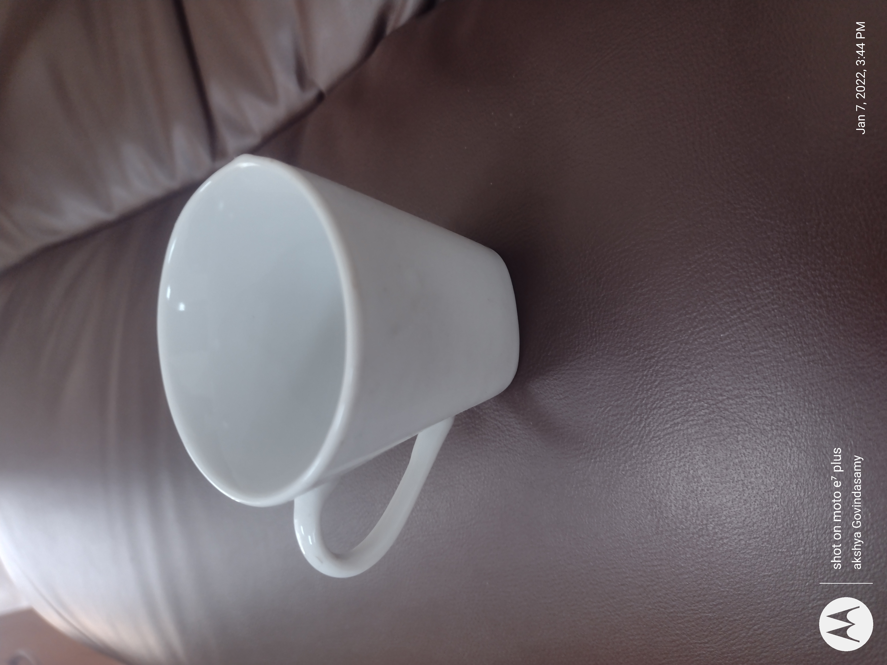

# EC66 · 活动分阶段日程与参与条件说明卡

[全部提示词](../README.md) · [首页](../../README.md)

**分类：广告与详情 · 本库原创设计**

把商家审定的预览／选购等阶段、准确时间与参与边界排成面向买家的活动说明，不猜优惠或实时状态。

## 准备材料与变量

图1为有权使用的完整商品原照；文字另提供活动标题、明确时区、人工审定的1–3条阶段（每条名称／起止／条件）、适用对象和总边界。条件与时间不由照片提供。没有图片选完整纯文字分支；缺起止、时区、适用范围或必要条件时先补审定文案，不由模型补规则。

将下表中的值按实际任务填写，然后复制正文。示例值用于说明填写方式，不是已核实的商品事实。

| 变量 | 填写示例或说明 |
| --- | --- |
| `{{标题}}` | 杯具主题日程（排版练习） |
| `{{活动时区}}` | 北京时间（UTC+8） |
| `{{商品职责}}` | 图1杯具完整原照仅作本例配图，杯口、杯把及环境按原照，不推容量、材质或在售货号 |
| `{{阶段清单}}` | 预览｜2026-11-09 10:00—2026-11-10 09:59｜仅浏览展示，无下单权益；选购｜2026-11-10 10:00—2026-11-11 22:00｜本例不设折扣、满减或赠品 |
| `{{适用范围}}` | 图示杯具仅作排版素材，非真实在售SKU |
| `{{边界说明}}` | 练习日程，不代表原作者实际活动；不承诺库存、发货与价格 |
| `{{文字版适用范围}}` | 本例仅展示杯具主题的练习日程，不对应真实在售SKU |
| `{{文字版边界说明}}` | 排版练习，非实际活动；不承诺库存、发货与价格 |

## 拿来就用的具体示例

图1使用下方Akshaya govindasamy／CC BY-SA 4.0杯具原照，完整保留相机、作者及日期标记。另提供本卡已填好的两阶段练习文案；它是自拟排版示例，不是该作者、品牌、店铺或平台的真实活动。

按示例准备对应素材后，直接复制下段；其他商品使用后面的变量模板。

```text
做一张4:5竖版、面向买家的活动阶段说明卡。图1职责：图1杯具完整原照仅作本例配图，杯口、杯把及环境按原照，不推容量、材质或在售货号。照片完整置入单独矩形窗，不裁切、去署名、改曝光、换背景或重绘商品；照片里的作者／相机／日期标记原样保留，不把它们当活动日期或店铺背书。

四边5%安全区，安全区内自上而下：标题与时区12%、间隔3%、完整原照窗28%、间隔3%、阶段列表42%、适用及总边界12%，合计100%。阅读顺序是标题／时区→配图→阶段名称／起止→同块条件→适用边界；条件字号不能变成难读脚注。照片按窗口等比contain，空余留白，不拉伸杯体或裁掉原图标记。1–3个阶段按人工顺序等分列表区，只有一条就整区使用，不留虚构阶段占位；不增按钮、倒计时、二维码、平台标志或价格章。

活动标题“杯具主题日程（排版练习）”；时区“北京时间（UTC+8）”；人工阶段清单（逐行名称、起止和条件）：
预览｜2026-11-09 10:00—2026-11-10 09:59｜仅浏览展示，无下单权益
选购｜2026-11-10 10:00—2026-11-11 22:00｜本例不设折扣、满减或赠品
适用范围“图示杯具仅作排版素材，非真实在售SKU”；总边界“练习日程，不代表原作者实际活动；不承诺库存、发货与价格”。这些文字逐字上屏，不自动回答、改写或补规则；不把预览写成预售、把选购写成限时折扣，不根据当前日期标已开始／已结束，不算倒计时、不生成库存或发货承诺。每一阶段的起止与条件必须同一信息块内，年份、时区、标点与截止时刻不省略。时间、阶段顺序或条件相互矛盾时先停下确认，不擅自校正。

背景米白，文字深灰，阶段编号只用单一低饱和蓝色点缀；不画礼物、优惠券或性能图标。只输出一张完成卡。文案超出可读布局时先缩减经人工审定的内容或转外部排字，不漏条件、改字或缩成小字；证据照片需逐像素保留时用外部图层排版。
```


## 完整提示词

```text
做一张4:5竖版、面向买家的活动阶段说明卡。图1职责：{{商品职责}}。照片完整置入单独矩形窗，不裁切、去署名、改曝光、换背景或重绘商品；照片里的作者／相机／日期标记原样保留，不把它们当活动日期或店铺背书。

四边5%安全区，安全区内自上而下：标题与时区12%、间隔3%、完整原照窗28%、间隔3%、阶段列表42%、适用及总边界12%，合计100%。阅读顺序是标题／时区→配图→阶段名称／起止→同块条件→适用边界；条件字号不能变成难读脚注。照片按窗口等比contain，空余留白，不拉伸杯体或裁掉原图标记。1–3个阶段按人工顺序等分列表区，只有一条就整区使用，不留虚构阶段占位；不增按钮、倒计时、二维码、平台标志或价格章。

活动标题“{{标题}}”；时区“{{活动时区}}”；人工阶段清单（逐行名称、起止和条件）：
{{阶段清单}}
适用范围“{{适用范围}}”；总边界“{{边界说明}}”。这些文字逐字上屏，不自动回答、改写或补规则；不把预览写成预售、把选购写成限时折扣，不根据当前日期标已开始／已结束，不算倒计时、不生成库存或发货承诺。每一阶段的起止与条件必须同一信息块内，年份、时区、标点与截止时刻不省略。时间、阶段顺序或条件相互矛盾时先停下确认，不擅自校正。

背景米白，文字深灰，阶段编号只用单一低饱和蓝色点缀；不画礼物、优惠券或性能图标。只输出一张完成卡。文案超出可读布局时先缩减经人工审定的内容或转外部排字，不漏条件、改字或缩成小字；证据照片需逐像素保留时用外部图层排版。
```

## 参数设置

建议画布：`1536x1920`；模型选择及格式见[模型说明](../../guides/models.md)。网页版可按相同比例描述画布。

本卡是买家活动说明成片，不是内部日程核对表、自动倒计时或EC52价格主视觉。示例全部为排版练习，不代表照片作者、品牌或平台实际活动；真实使用必须替换为审定规则并人工核对时间与条件。

## 可复制变体

选择一个版本，替换变量后整段复制；每段已包含基础要求。

### 无商品图纯文字版 · text-only-schedule

```text
只根据人工审定文字制作一张4:5竖版活动阶段说明卡，不需要图片，不生成商品轮廓、商品照片、人物或装饰性样机。

四边5%安全区，安全区内标题与时区15%、间隔5%、阶段列表60%、间隔5%、适用与总边界15%，合计100%。阅读顺序标题／时区→每阶段名称／起止／同块条件→范围与总边界；1–3阶段按人工顺序等分列表区，不补空阶段。米白背景、深灰文字、单一低饱和蓝色细线，保留足够行距，条件与时间同块且清晰可读。

活动标题“{{标题}}”；时区“{{活动时区}}”；人工阶段清单（逐行名称、起止和条件）：
{{阶段清单}}
适用范围“{{文字版适用范围}}”；总边界“{{文字版边界说明}}”。这些文字逐字上屏，不自动回答、改写或补规则；不把预览写成预售、把选购写成限时折扣，不根据当前日期标已开始／已结束，不算倒计时、不生成库存或发货承诺。每一阶段的起止与条件必须同一信息块内，年份、时区、标点与截止时刻不省略。时间、阶段顺序或条件相互矛盾时先停下确认，不擅自校正。

不引用缺失商品图、不从标题猜SKU或文案，不生成优惠券、赠品、按钮、倒计时、二维码、平台标志或价格章。只输出一张完成卡；文字放不下先由人工精简审定文案或转外部排字，不擅改时区、删条件或压成小字。
```

修改前，将修改指令中的双花括号内容按实际问题填写；每次只处理一个位置。

## 接着修改

上传上一轮结果；涉及商品或人物时，同时保留原始参考图。

```text
以上一轮活动卡为底图，只修正{{阶段名称}}中的{{唯一字段}}为“{{审定新文字}}”；若该字段关联其他条件，先取得完整修订清单，不擅自改第二项。有照片时保留原照；纯文字版不补图。其他阶段的时间和条件、时区、适用范围、留白与字号层级不变。只输出一张修改图；时间变更后由人工核对所有阶段，不自动推新优惠或状态。
```

## 来源

- [OpenAI GPT Image 2.5提示词指南 · 构图、参考职责与编辑边界](https://developers.openai.com/api/docs/guides/image-prompting)
- [Wikimedia Commons · Akshaya govindasamy · 杯具实拍与逐图CC许可](https://commons.wikimedia.org/wiki/File:Coffee_cup_image.jpg)

### 真实输入参考 · 杯具原照 · 仅活动排版输入



摄影／作者：Akshaya govindasamy · [CC BY-SA 4.0](https://creativecommons.org/licenses/by-sa/4.0/) · [原始文件页](https://commons.wikimedia.org/wiki/File:Coffee_cup_image.jpg)。

图1只负责原照中杯体、杯口、左侧把手与原环境的可见外观；完整原照作为照片窗，不抠出、去署名或重画，不由照片推容量、材质、安全、现售SKU或活动规则。日程与条件全部是人工教学文案，不代表原作者实际活动。

保留原始JPEG，未裁切、未改色、未去除相机／作者／日期标记；网页只等比缩放。原照3000×4000（含方向元数据），不是模型输出；公开改编遵守署名和适用的相同方式共享要求。

许可核查：2026-11-02。这是输入素材，不是本卡生成效果；照片及其改编不自动适用本库MIT，公开改编须保留署名、许可和改动说明，并遵守适用的相同方式共享条件。

整理日期：2026-11-02。上游许可及第三方素材边界见[署名说明](../../ATTRIBUTIONS.md)。
